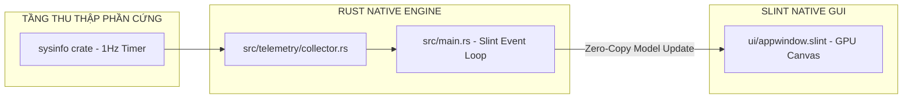

# 🛸 Orbit System Manager

[](https://github.com/ryantr-statinops/Orbit-System-Manager/releases)

**Phần mềm giám sát hệ thống thời gian thực siêu nhẹ — 100% Pure Native Rust & Slint UI**


Orbit System Manager là desktop app giám sát hiệu năng hệ thống theo thời gian thực được xây dựng hoàn toàn bằng **Rust** và **Slint GUI Framework**. Ứng dụng hoạt động trực tiếp với phần cứng, không sử dụng WebView, không phụ thuộc Chromium/Node.js, đem lại hiệu năng vượt trội với mức tiêu thụ tài nguyên tối thiểu.

---

## ⚡ Điểm nổi bật (Highlights)

* **🚀 Siêu nhẹ (Ultralight):** Tiêu thụ chỉ **~15 – 25 MB RAM**, khởi động tức thì trong **< 30 mili-giây**.
* **🦀 100% Pure Rust:** Không Node.js, không Python, không WebView2/WebKit. Toàn bộ logic hệ thống và render đồ hoạ chạy trên mã máy native.
* **🎨 Giao diện Slint hiện đại:** Thiết kế 3 cột trực quan với animation mượt mà, hỗ trợ render tăng tốc phần cứng bằng GPU (OpenGL / Vulkan).
* **📊 Trực quan hoá toàn diện:**
  * **System Memory:** Đo dung lượng RAM đã dùng, tổng RAM và thanh phần trăm động.
  * **CPU Cores:** Hiển thị 16 lõi CPU kèm thanh tiến trình đổi màu theo mức tải (xanh $\rightarrow$ vàng $\rightarrow$ đỏ).
  * **HUD Stats:** Tính toán trực tiếp Average Utilization, Standard Deviation và Variance.
  * **GPU & Network:** Theo dõi tải GPU, nhiệt độ, cùng tốc độ Download/Upload theo thời gian thực.

---

## 🏗️ Kiến trúc kỹ thuật (Pure Rust & Slint)



### Công nghệ sử dụng

| Thành phần | Công nghệ |
| :--- | :--- |
| **Ngôn ngữ cốt lõi** | Rust (Edition 2021) |
| **GUI Framework** | [Slint](https://slint.dev) (v1.9) |
| **System Telemetry** | [sysinfo](https://crates.io/crates/sysinfo) (v0.33) |
| **Serialization** | `serde` + `serde_json` |
| **CI / CD Container** | Docker (Ubuntu 22.04 Native Build) |

---

## ⚙️ Hướng dẫn phát triển (Development)

### Yêu cầu
* [Rust & Cargo](https://www.rust-lang.org) (≥ 1.77)

### 1. Chạy ở chế độ Development

```bash
cargo run
```

### 2. Build bản phát hành (Release Binary)

```bash
cargo build --release
```

Tệp nhị phân độc lập sau khi build sẽ nằm tại:
* **Windows:** `target/release/orbit-system-manager.exe`
* **Linux:** `target/release/orbit-system-manager`
* **macOS:** `target/release/orbit-system-manager`

---

## 📁 Cấu trúc thư mục

```
Orbit-System-Manager/
├── Cargo.toml          # Rust package manifest & dependencies (Slint, sysinfo)
├── build.rs            # Slint UI build script (compiles appwindow.slint)
├── src/
│   ├── main.rs         # Entry point, Slint models binding, 1Hz timer
│   ├── lib.rs          # Export telemetry module
│   └── telemetry/      # Module thu thập số liệu phần cứng bằng sysinfo
│       ├── mod.rs
│       ├── models.rs   # Data structures (CpuDetail, MemoryDetail, GpuMetric)
│       └── collector.rs # Logic đọc CPU, RAM, Network
├── ui/
│   └── appwindow.slint # Định nghĩa toàn bộ giao diện Slint (layout 3 cột, HUD)
├── assets/
│   ├── icons/          # App icons (.ico, .png, .icns)
│   └── images/         # Screenshots
├── .github/workflows/  # CI / CD tự động build test trên Linux, Windows, macOS
└── Dockerfile.build-linux # Container build độc lập cho Linux
```

---

## 📄 Giấy phép

MIT License.
