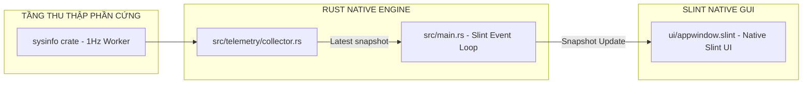

# 🛸 Orbit System Manager

[](https://github.com/ryantr-statinops/Orbit-System-Manager/releases)

**Ứng dụng desktop giám sát CPU, RAM và lưu lượng mạng bằng Rust và Slint.**


Orbit System Manager thu thập CPU, RAM và lưu lượng mạng theo thời gian thực. Collector chạy trên worker riêng; biểu đồ history CPU được rasterize bằng CPU và hiển thị trong Slint. GPU chưa được hỗ trợ và được ghi là N/A.

---

## ⚡ Điểm nổi bật (Highlights)

* **🦀 Ứng dụng native:** Không dùng Node.js hoặc WebView.
* **🎨 Giao diện Slint:** Dashboard native với history được vẽ bằng CPU.
* **📊 Trực quan hoá toàn diện:**
  * **System Memory:** Đo dung lượng RAM đã dùng, tổng RAM và thanh phần trăm động.
  * **CPU Cores:** Hiển thị tất cả logical processors của máy.
  * **HUD Stats:** Tính toán trực tiếp Average Utilization, Standard Deviation và Variance.
  * **Network:** Theo dõi tốc độ gửi/nhận theo KiB/s, tổng hợp trên mọi interface. GPU hiện N/A.

---

## 🏗️ Kiến trúc kỹ thuật (Rust & Slint)



### Công nghệ sử dụng

| Thành phần | Công nghệ |
| :--- | :--- |
| **Ngôn ngữ cốt lõi** | Rust (Edition 2021) |
| **GUI Framework** | [Slint](https://slint.dev) (v1.18.1) |
| **System Telemetry** | [sysinfo](https://crates.io/crates/sysinfo) (v0.33) |
| **Serialization** | `serde` + `serde_json` |
| **CI / CD Container** | Docker (Ubuntu 22.04 Native Build) |

---

## ⚙️ Hướng dẫn phát triển (Development)

### Yêu cầu
* [Rust & Cargo](https://www.rust-lang.org) (≥ 1.99.1)

### 1. Chạy ở chế độ Development

```bash
cargo run --locked
```

### 2. Build bản phát hành (Release Binary)

```bash
cargo build --locked --release
```

Tệp nhị phân độc lập sau khi build sẽ nằm tại:
* **Windows:** `target/release/orbit-system-manager.exe`
* **Linux:** `target/release/orbit-system-manager`
* **macOS:** `target/release/orbit-system-manager`

---

## 📁 Cấu trúc thư mục

```
Orbit-System-Manager/
├── Cargo.toml          # Rust package manifest & dependencies (Slint, sysinfo)
├── Cargo.lock          # Locked dependency versions
├── build.rs            # Slint UI build script (compiles appwindow.slint)
├── src/
│   ├── main.rs         # Entry point, worker snapshots and Slint bindings
│   ├── lib.rs          # Export telemetry module
│   └── telemetry/      # Module thu thập số liệu phần cứng bằng sysinfo
│       ├── mod.rs
│       ├── models.rs   # CPU, memory, GPU availability and network data
│       └── collector.rs # Logic đọc CPU, RAM, Network
├── ui/
│   └── appwindow.slint # Giao diện dashboard hai vùng, có thể cuộn
├── assets/
│   ├── icons/          # App icons (.ico, .png, .icns)
│   └── images/         # Screenshots
├── .github/workflows/  # CI kiểm tra Linux, Windows, macOS và build release
└── Dockerfile.build-linux # Container build độc lập cho Linux
```

---

## 📄 Giấy phép

MIT License.
