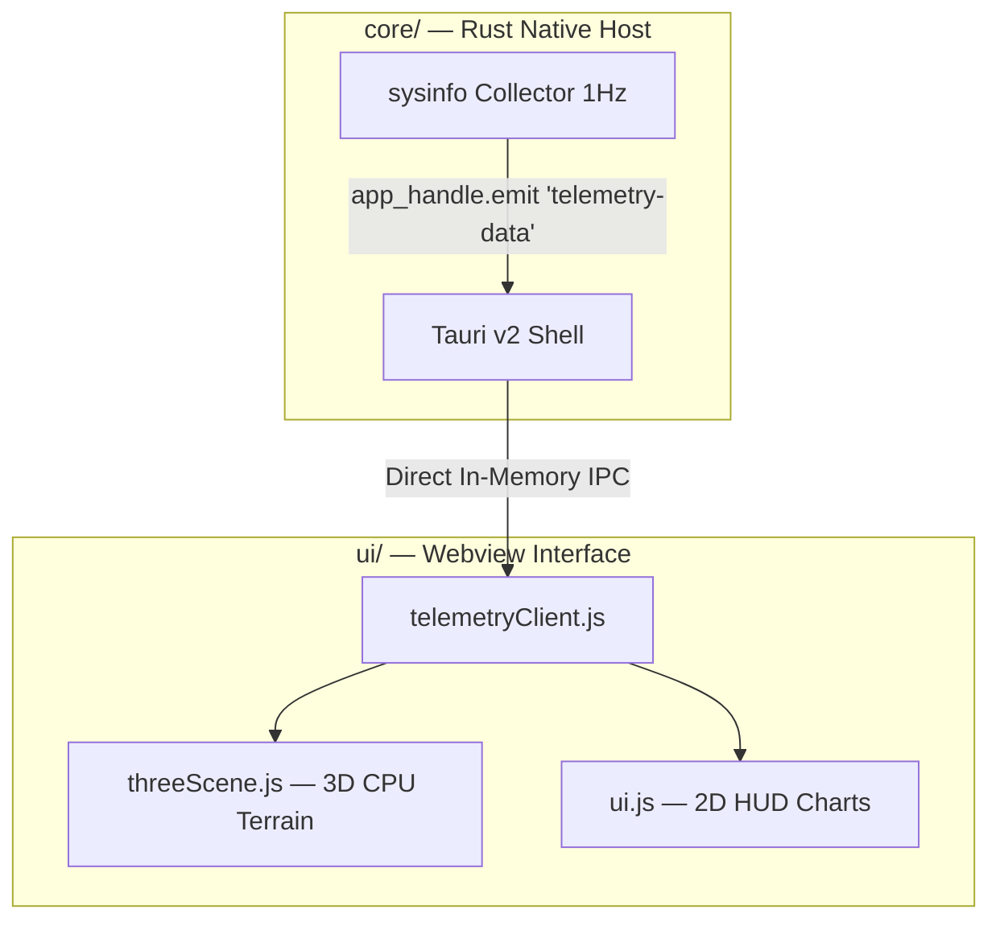

# 🛸 Orbit System Manager

[](https://github.com/ryantr-statinops/Orbit-System-Manager/releases)

**Ứng dụng giám sát hệ thống thời gian thực với trực quan hoá 3D CPU, RAM, GPU và Network (Pure Rust & Tauri v2)**


Orbit System Manager là desktop app giám sát hiệu năng hệ thống theo thời gian thực. Sử dụng **trực quan hoá 3D** hiển thị tải CPU dưới dạng topology động, kết hợp biểu đồ thống kê (boxplot, density plot, time‑series) và HUD hiển thị thông số chi tiết.

---

## 📥 Tải & Cài đặt

### Cách 1: Download từ GitHub Releases (khuyên dùng)

1. Truy cập **[Releases](https://github.com/ryantr-statinops/Orbit-System-Manager/releases)** của repo này
2. Tải file mới nhất:
   - **`Orbit-System-Manager_x64-setup.exe`** — dành cho Windows (NSIS installer)
   - **`.AppImage` / `.deb`** — dành cho Linux
   - **`.dmg`** — dành cho macOS
3. Cài đặt và mở app từ Start Menu / Applications 🎉

> **Lưu ý:** Windows Defender có thể hiện cảnh báo "Windows protected your PC". Nhấn **"More info"** → **"Run anyway"** để tiếp tục.

### Cách 2: Tải Portable (không cần cài đặt)

Trong mục **Releases**, tải file `.zip` và giải nén, chạy `Orbit System Manager.exe`.

---

## 🚀 Hướng dẫn sử dụng

### Khi app khởi động

App sẽ tự động:
1. Mở cửa sổ desktop native siêu nhẹ với giao diện 3 cột
2. Khởi chạy luồng đo phần cứng native bằng Rust (`sysinfo`) với tần số 1 Hz
3. Tự động stream dữ liệu trực tiếp vào WebView qua kênh bộ nhớ Tauri IPC nội bộ (zero network overhead)
4. Nếu mở trên trình duyệt web độc lập bên ngoài Tauri, app tự động chuyển sang chế độ **dữ liệu mô phỏng (Mock Telemetry)**

### Các thao tác chính

| Thao tác | Mô tả |
| :--- | :--- |
| **🖱️ Kéo thả splitter (gạch dọc)** | Resize 3 cột, kích thước được lưu tự động |
| **◀▶ Nhấn nút mũi tên trên thanh top bar** | Ẩn/hiện panel trái và phải |
| **🔄 Xoay 3D** | Giữ chuột trái + kéo trên canvas 3D |
| **🔍 Zoom 3D** | Lăn chuột trên canvas 3D |
| **📌 Pan 3D** | Giữ chuột phải + kéo |

### Giao diện

**Panel trái (bên trái):**
- **System Memory** — thanh RAM tổng quan + dung lượng đã dùng
- **CPU Cores** — 16 lõi CPU với thanh tải % + sparkline 40 mẫu
- **HUD** — Avg utilization, std dev, variance, kết nối real-time

**Trung tâm (Canvas 3D):**
- CPU topology 3D — mỗi cột là một lõi CPU, cao/thấp theo tải
- Boxplot + stripplot phân bố tải 16 lõi
- RAM time‑series (30 giây)
- Network chart (Sent / Received)

**Panel phải (bên phải):**
- **GPU0 / GPU1** — Density plot + Time‑series (load %, VRAM, temperature)
- **RAM Time‑Series** — biểu đồ đường RAM 30 giây
- **Network** — Sent / Received (KB/s)

---

## 🔧 Yêu cầu hệ thống

| Yêu cầu | Tối thiểu |
| :--- | :--- |
| **Hệ điều hành** | Windows 10/11, Ubuntu 22.04+ (Linux), macOS 11+ |
| **RAM** | < 50 MB khi app đang chạy |
| **GPU** | Hỗ trợ WebGL |

---

## 🏗️ Tổng quan kiến trúc



### Công nghệ sử dụng

| Thành phần | Công nghệ |
| :--- | :--- |
| **Desktop Shell & Telemetry** | [Tauri v2](https://tauri.app) (Rust) + [sysinfo](https://crates.io/crates/sysinfo) |
| **Frontend UI** | Vanilla JS + [Three.js](https://threejs.org) + Canvas 2D API |
| **Bundler** | [Rollup](https://rollupjs.org) |
| **CI / CD Container** | Docker (Ubuntu 22.04 + WebKitGTK) |

---

## ⚙️ Dành cho nhà phát triển

### Yêu cầu

| Công cụ | Phiên bản |
| :--- | :--- |
| [Node.js](https://nodejs.org) | ≥ 18 |
| [Rust & Cargo](https://www.rust-lang.org) | ≥ 1.77 |

### Cài đặt & Build

```bash
# 1. Clone repository
git clone https://github.com/ryantr-statinops/Orbit-System-Manager.git
cd Orbit-System-Manager

# 2. Cài đặt npm dependencies
npm install

# 3. Build frontend bundle
npm run build

# 4. Build ứng dụng desktop (ra file .msi / .exe / .deb / .AppImage)
npm run build:app
```

File cài đặt sau khi build sẽ nằm tại:

| Định dạng | Đường dẫn |
| :--- | :--- |
| 📦 **MSI** | `core/target/release/bundle/msi/` |
| 📦 **NSIS (.exe)** | `core/target/release/bundle/nsis/` |
| 📦 **AppImage / DEB** | `core/target/release/bundle/appimage/` hoặc `deb/` |

### Chạy chế độ development

```bash
npm run dev
```

Lệnh `npm run dev` sẽ tự động:
1. Chạy `node scripts/dev-server.mjs` (static server tại port 3000)
2. Mở WebView window của Tauri trỏ tới `http://localhost:3000`
3. Kích hoạt luồng telemetry Rust và stream dữ liệu trực tiếp vào UI

---

## 📁 Cấu trúc thư mục

```
Orbit-System-Manager/
├── core/                # Rust Native Core & Tauri Host
│   ├── Cargo.toml       # Rust dependencies (sysinfo, tauri v2, serde)
│   ├── tauri.conf.json  # Desktop window & bundle configuration
│   └── src/
│       ├── main.rs      # Native entry point
│       ├── lib.rs       # Tauri builder & telemetry event loop
│       └── telemetry/   # Hardware telemetry collector (sysinfo)
│           ├── mod.rs
│           ├── models.rs
│           └── collector.rs
├── ui/                  # Frontend UI Source (Web / JS modules)
│   ├── index.js         # Entry point
│   ├── state.js         # Global state
│   ├── ui.js            # Charts, HUD, layout
│   ├── threeScene.js    # 3D CPU topology (Three.js)
│   ├── timeSeries.js    # Time‑series data structures
│   ├── telemetryClient.js # Tauri IPC event listener + mock fallback
│   └── constants.js     # Constants
├── agent/               # Architectural plans & specifications
├── assets/images/       # Screenshots & assets
├── Dockerfile.build-linux # Linux packaging build container
├── index.html           # Entry HTML
├── style.css            # Styles
├── rollup.config.js     # Rollup bundler config
└── package.json         # npm scripts & dependencies
```

---

## 📄 Giấy phép

MIT License.
