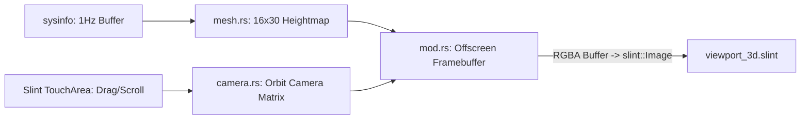

# Slint Modular UI Architecture & Native 3D Pipeline

Tài liệu này mô tả chi tiết kiến trúc giao diện native của **Orbit System Manager (v2.0)**:
1. Hệ thống thành phần module hoá (**Modular Slint Components**).
2. Hệ thống Design Tokens Dark Theme có thể tuỳ biến (**`ui/theme.slint`**).
3. Pipeline kết xuất đồ hoạ 3D CPU Topology thuần Rust (**`src/renderer/`**).

---

## 🎨 Cấu trúc Component Module Hoá (`ui/`)

Toàn bộ giao diện được phân tách thành các component độc lập:

```
ui/
├── theme.slint               # Design tokens, màu sắc Dark Theme mặc định
├── appwindow.slint           # Master Window (kết nối và bố trí layout 3 cột)
└── components/
    ├── core_bar.slint        # Thanh tiến trình tải từng nhân CPU
    ├── stat_card.slint       # Thẻ hiển thị chỉ số HUD
    ├── left_panel.slint      # Cột trái: RAM + 16 CPU Core Bars + Stats
    ├── right_panel.slint     # Cột phải: GPU Telemetry + Tốc độ Mạng
    └── viewport_3d.slint     # Cột giữa: Khung nhìn 3D & TouchArea tương tác chuột
```

---

## 🌓 Hệ thống Design Tokens (`ui/theme.slint`)

Giao diện mặc định theo phong cách **Dark Theme** hiện đại, được quản lý tập trung qua singleton `Theme`:

| Token | Giá trị mặc định | Vai trò |
| :--- | :--- | :--- |
| `Theme.app_bg` | `#0d1117` | Nền chính của toàn bộ cửa sổ |
| `Theme.card_bg` | `#161b22` | Nền các khối panel và thẻ theo dõi |
| `Theme.border` | `#30363d` | Đường viền ngăn cách tinh tế |
| `Theme.text_primary` | `#f0f6fc` | Chữ chính (tiêu đề, giá trị số) |
| `Theme.text_secondary` | `#8b949e` | Chữ phụ, nhãn nhỏ |
| `Theme.accent` | `#58a6ff` | Màu xanh điểm nhấn tương tác |
| `Theme.teal_primary` | `#21918c` | Màu Viridis Teal cho tải bình thường |
| `Theme.warning` | `#d29922` | Màu cảnh báo khi tải > 55% |
| `Theme.danger` | `#f85149` | Màu cảnh báo cao khi tải > 85% |

> **Cách tuỳ chỉnh giao diện sau này:** Chỉ cần chỉnh sửa các mã màu trong `ui/theme.slint`, toàn bộ giao diện từ các nút, thanh tiến trình cho tới thẻ thống kê sẽ tự động cập nhật đồng bộ.

---

## 🌐 Pipeline Kết xuất 3D Native (`src/renderer/`)

Khung nhìn 3D trung tâm được kết xuất trực tiếp bằng Rust thông qua pipeline đồ hoạ chuyên dụng:



### 1. Lưới địa hình (`src/renderer/mesh.rs`)
* **Kích thước lưới:** 16 nhân CPU $\times$ 30 mốc thời gian = **480 đỉnh** (870 đoạn thẳng liên kết).
* **Độ mượt (Interpolation):** Thuật toán Lerp chạy tại tần số ~30 FPS ($\alpha = 0.12$) giúp các đỉnh trượt mượt mà khi mức tải CPU thay đổi.
* **Bảng màu Viridis Neon:** Tự động tính toán gradient màu sắc từ Tím (`#440154`) $\rightarrow$ Xanh Teal (`#21918c`) $\rightarrow$ Vàng Neon (`#fde725`) dựa trên độ cao tải thực tế.

### 2. Camera điều khiển Orbit (`src/renderer/camera.rs`)
* **Xoay (Orbit):** Bắt sự kiện kéo chuột trái (`rotate_3d`) để xoay góc Yaw (ngang) và Pitch (dọc).
* **Phóng to / Thu nhỏ (Zoom):** Bắt sự kiện lăn chuột giữa (`zoom_3d`) để tịnh tiến khoảng cách camera từ 20 đến 150 đơn vị.
* **Di chuyển (Pan):** Bắt sự kiện kéo chuột phải (`pan_3d`) để dịch chuyển tâm nhìn.
* **Phép chiếu (Perspective Projection):** Tính ma trận phối cảnh 3D sang toạ độ màn hình 2D $(X, Y)$ kèm hiệu ứng viễn cận.

---

## 🔗 Liên kết dữ liệu giữa Rust và Slint (Data Binding)

| Thuộc tính Slint | Kiểu dữ liệu | Mô tả |
| :--- | :--- | :--- |
| `cpu_avg`, `cpu_std`, `cpu_var` | `float` | Thống kê tải trung bình, độ lệch chuẩn và phương sai |
| `cores` | `[CoreItem]` | Mảng 16 phần tử `{ id, load }` |
| `ram_percent`, `ram_used_gb`, `ram_total_gb` | `float` | Dung lượng và phần trăm sử dụng RAM |
| `net_sent_kbps`, `net_recv_kbps` | `float` | Tốc độ gửi và nhận mạng qua card mạng chính |
| `gpu_load`, `gpu_temp`, `gpu_name` | `float`, `string` | Thông số GPU rời / GPU tích hợp |
| `viewport_3d_frame` | `image` | Khung hình 3D kết xuất từ OffscreenRenderer |
| `rotate_3d`, `pan_3d`, `zoom_3d` | `callback` | Tín hiệu tương tác chuột gửi từ Slint sang Rust |
