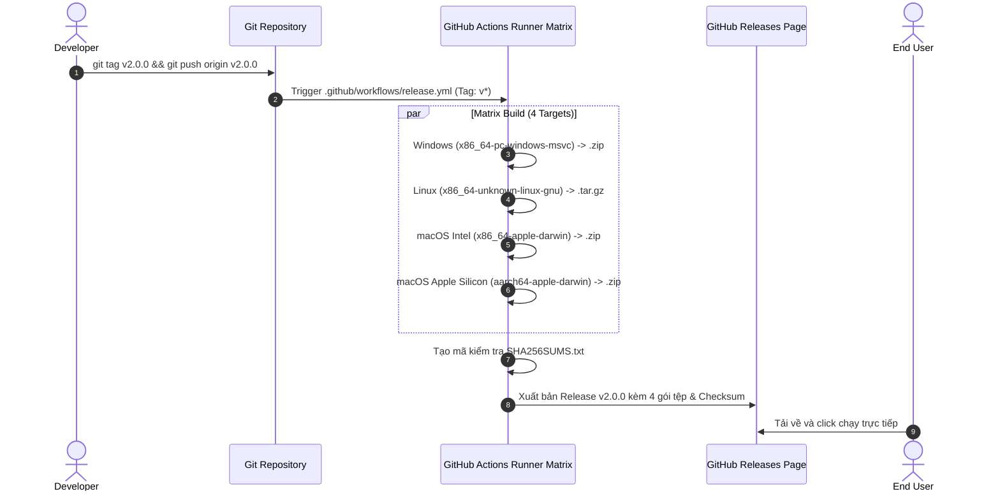

# Automated Release & Cross-Platform Distribution Guide

Tài liệu này hướng dẫn chi tiết quy trình đóng gói và phát hành tự động đa nền tảng (Windows, Linux, macOS) cho **Orbit System Manager** thông qua **GitHub Actions CI/CD** và cấu hình tối ưu của **Cargo**.

> 📌 **Phiên bản hiện tại:** `v2.1.0` (Pure Native Rust & Slint v1.18.1)
> **Định vị cốt lõi:** Một công cụ giám sát hệ thống siêu nhẹ (**Lightweight System Monitor**) hiển thị toàn bộ trạng thái phần cứng (16 nhân CPU, RAM, GPU, Network) trực quan gói gọn **trong một màn hình duy nhất (All-in-one Single Screen)** mà không cần cuộn trang hay chuyển tab.

---

## 1. Cơ chế hoạt động (How It Works)

Toàn bộ quy trình phát hành được tự động hóa 100%: **Không cần biên dịch thủ công trên từng máy tính cá nhân**.



---

## 2. Tối ưu hoá kích thước nhị phân (`Cargo.toml`)

Trước khi biên dịch phân phối, `Cargo.toml` được cấu hình hồ sơ phát hành (`[profile.release]`) với các cờ tối ưu mã máy cao nhất:

```toml
[profile.release]
opt-level = 3        # Mức tối ưu hoá tốc độ CPU cao nhất
lto = true           # Link-Time Optimization (xoá dead-code xuyên crate)
codegen-units = 1    # Gom thành 1 đơn vị sinh mã để nén kích thước tối đa
panic = "abort"      # Bỏ bảng unroll stack không cần thiết
strip = true         # Tự động gỡ bỏ debug symbols khỏi file thực thi
```

* **Kết quả:** Giảm kích thước tệp thực thi từ **~22 MB** xuống chỉ còn **~8 – 10 MB**.

---

## 3. Ma trận biên dịch đa nền tảng (`.github/workflows/release.yml`)

Workflow được kích hoạt tự động mỗi khi có một Git Tag mới bắt đầu bằng `v*`:

| Nền tảng | Rust Target | Môi trường GitHub Runner | Tên tệp xuất bản |
| :--- | :--- | :--- | :--- |
| **Windows (64-bit)** | `x86_64-pc-windows-msvc` | `windows-latest` | `orbit-system-manager-windows-x86_64.zip` |
| **Linux (64-bit)** | `x86_64-unknown-linux-gnu` | `ubuntu-22.04` | `orbit-system-manager-linux-x86_64.tar.gz` |
| **macOS (Intel)** | `x86_64-apple-darwin` | `macos-latest` | `orbit-system-manager-macos-x86_64.zip` |
| **macOS (Apple Silicon)** | `aarch64-apple-darwin` | `macos-latest` | `orbit-system-manager-macos-aarch64.zip` |

### Bảo mật & Kiểm tra tính toàn vẹn (Checksums)
Trước khi xuất bản, workflow tự động chạy:
```bash
sha256sum * > SHA256SUMS.txt
```
Tệp `SHA256SUMS.txt` được đính kèm vào trang Release để người dùng có thể đối chiếu chữ ký mã băm sau khi tải về, đảm bảo tệp không bị can thiệp trên đường truyền.

---

## 4. Hướng dẫn từng bước phát hành phiên bản mới

Khi bạn hoàn thành tính năng hoặc sửa lỗi và muốn tạo một bản phát hành mới cho người dùng:

### Bước 1: Cập nhật phiên bản trong `Cargo.toml`
Mở `Cargo.toml` và cập nhật trường `version`:
```toml
[package]
version = "2.0.0"
```

### Bước 2: Commit và tạo Git Tag
Chạy các lệnh sau trong terminal:
```bash
# 1. Commit thay đổi phiên bản
git add Cargo.toml
git commit -m "chore: bump version to v2.0.0"
git push origin main

# 2. Tạo nhãn tag phiên bản
git tag v2.0.0

# 3. Đẩy tag lên GitHub để kích hoạt build tự động
git push origin v2.0.0
```

### Bước 3: Theo dõi quá trình xuất bản
1. Vào kho lưu trữ trên GitHub $\rightarrow$ tab **Actions**.
2. Bạn sẽ thấy workflow **Release / Multi-Platform Build & Publish** đang chạy song song 4 jobs.
3. Sau 3 – 5 phút, vào mục **Releases** trên GitHub, bạn sẽ thấy bản phát hành **Orbit System Manager v2.0.0** đã sẵn sàng với đầy đủ các tệp tải về.

---

## 5. Hướng dẫn dành cho Người dùng cuối (End-User Run Guide)

* **Windows:** Tải file `.zip`, giải nén và double-click chạy `orbit-system-manager.exe`.
* **Linux:** Tải file `.tar.gz`, giải nén và cấp quyền thực thi:
  ```bash
  tar -xvf orbit-system-manager-linux-x86_64.tar.gz
  chmod +x orbit-system-manager
  ./orbit-system-manager
  ```
* **macOS:** Tải file `.zip`, giải nén và mở file thực thi. *(Nếu Gatekeeper cảnh báo, mở System Settings $\rightarrow$ Privacy & Security $\rightarrow$ Click "Open Anyway")*.
