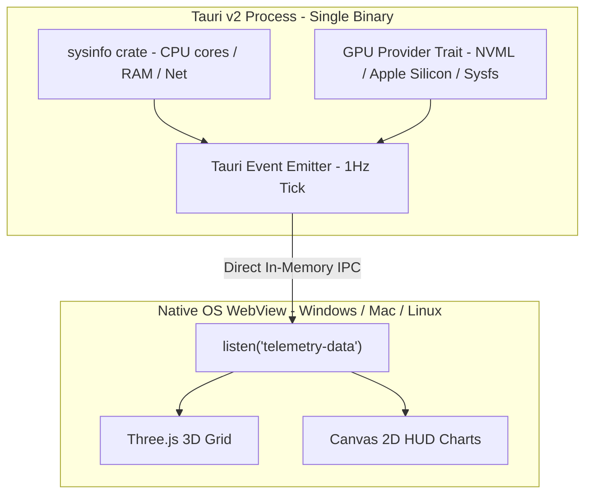

# Plan 02 — Pure Rust Native Telemetry & Cross-Platform Migration

> **Mục tiêu:** Chuyển đổi 100% backend từ Python sidecar (`app.py` + WebSockets) sang module Rust native tích hợp trực tiếp trong Tauri v2. Ứng dụng xuất ra một file nhị phân duy nhất, khởi động < 100ms, tiêu thụ < 40MB RAM và tương thích hoàn toàn trên Windows, Linux, macOS.

---

## 1. Bối cảnh & Động lực chuyển dịch

### 1.1 Vấn đề của kiến trúc hiện tại (Python Sidecar + WebSocket)
* **Kích thước cồng kềnh:** PyInstaller binary nặng 40-70 MB vì phải nén toàn bộ Python runtime + DLLs C-extension.
* **Thời gian khởi động chậm:** 1-3 giây để giải nén temporary files và khởi động Python interpreter.
* **Xung đột cổng mạng:** WebSocket gắn cứng cổng `8080`, dễ bị xung đột với các service khác hoặc bị Windows Firewall / macOS Sandbox chặn popup cảnh báo.
* **Đa nền tảng phức tạp:** Cần build 3 binary Python riêng biệt cho Windows (`.exe`), Linux (ELF binary), macOS (Mach-O).

### 1.2 Kiến trúc mục tiêu (Pure Rust Native + Tauri IPC)

---

## 2. Lộ trình thực hiện 4 giai đoạn

### Giai đoạn 1: Đo lường CPU, RAM, Network bằng Crate `sysinfo`
* **Crate:** `sysinfo = "0.33"`
* **Chức năng:**
  * Lấy danh sách CPU per-core load (%) theo thời gian thực (tương đương `psutil.cpu_percent(percpu=True)`).
  * Lấy tổng dung lượng RAM, RAM đã dùng, swap (`psutil.virtual_memory()`).
  * Đo tốc độ mạng I/O `received_kbps` và `sent_kbps` qua interface delta.
* **Tương thích:** Tự động hỗ trợ Windows, Linux, macOS mà không cần sửa code.

### Giai đoạn 2: Trừu tượng hoá GPU đa nền tảng (GPU Provider Trait)
Thiết kế Trait với Conditional Compilation:
* **Windows & Linux (NVIDIA):** Dùng `nvml-wrapper = "0.10"`.
* **Linux (AMD / Intel):** Parse `/sys/class/drm/card*/device/gpu_busy_percent`.
* **macOS (Apple Silicon M-series):** Sử dụng `IOKit` / `Metal` FFI để lấy GPU utilization và Unified Memory.

### Giai đoạn 3: Chuyển dịch Frontend từ WebSocket sang Tauri IPC
* Gỡ bỏ logic kết nối `WebSocket('ws://127.0.0.1:8080')`.
* Cài đặt `@tauri-apps/api` (v2).
* Lắng nghe sự kiện qua `listen('telemetry-data', callback)`:
  * Khi chạy trong desktop app: nhận trực tiếp từ Rust.
  * Khi chạy dev web thuần: tự động bật Mock Telemetry.

### Giai đoạn 4: Thu dọn kỹ thuật & Đóng gói
* Xoá bỏ `app.py`, `environment.yml`, `requirements.txt`.
* Gỡ bỏ `tauri-plugin-shell` (không còn cần spawn tiến trình con).
* Cấu hình CI/CD Docker build tự động ra file `.msi` (Windows), `.AppImage` / `.deb` (Linux), `.dmg` (macOS).
