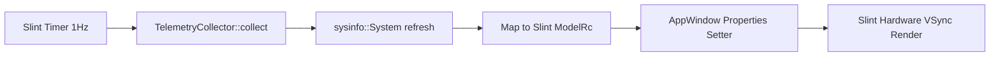

# Desktop App Integration & Architecture (Pure Rust & Slint)

> Tài liệu lịch sử, không phải chỉ dẫn triển khai hiện hành. Xem `AGENTS.md` và `docs/plan/implementation/README.md` ở gốc repository.

## 1. Architecture Overview

Dự án đã hoàn tất quá trình chuyển đổi kiến trúc qua 3 thế hệ:
1. **Thế hệ 1 (Legacy):** Lively Wallpaper (WebView widget chạy bằng HTML/JS + Three.js).
2. **Thế hệ 2 (Tauri v2 + Python):** Desktop shell bằng Tauri v2 kết hợp Python sidecar (`app.py`).
3. **Thế hệ 3 (Hiện tại — Pure Native Slint):** Loại bỏ hoàn toàn WebView, Node.js và Python. Ứng dụng là **một tệp thực thi độc lập (Standalone Native Binary)** viết 100% bằng **Rust** và sử dụng **Slint GUI Framework**.

---

## 2. Ưu thế vượt trội của kiến trúc mới

* **Khởi động tức thì (< 30ms):** Không có thời gian khởi động của Node.js runtime, không cần giải nén tạm thời Python DLLs.
* **Tiêu thụ RAM siêu thấp (~15 – 25 MB):** Giảm hơn 70% so với mô hình WebView (thường tốn 50 – 80 MB).
* **Đóng gói đơn giản:** Chỉ cần `cargo build --release`, xuất thẳng ra một file thực thi duy nhất (`.exe` trên Windows, ELF trên Linux, Mach-O trên macOS).
* **Bảo mật tuyệt đối:** Không mở bất kỳ cổng mạng nội bộ nào (như WebSocket `8080`), không lo đụng độ cổng hoặc cảnh báo từ tường lửa OS.

---

## 3. Cấu trúc mã nguồn

```
Orbit-System-Manager/
├── Cargo.toml          # Quản lý crates (slint, sysinfo, serde)
├── build.rs            # Slint UI compiler (biên dịch appwindow.slint)
├── src/
│   ├── main.rs         # Event loop, timer 1Hz, Slint Model Data-binding
│   ├── lib.rs          # Module declarations
│   └── telemetry/      # Module quét phần cứng native
│       ├── mod.rs
│       ├── models.rs   # Data structures (CpuDetail, MemoryDetail, GpuMetric)
│       └── collector.rs # Thu thập CPU, RAM, Network bằng sysinfo
└── ui/
    └── appwindow.slint # Toàn bộ mã nguồn giao diện native khai báo Slint
```

---

## 4. Vòng đời dữ liệu (Data Lifecycle)



1. **Chu kỳ 1 Giây:** Slint `Timer` tích hợp trong event loop kích hoạt hàm `collector.collect()`.
2. **Thu thập dữ liệu:** `sysinfo` đọc delta CPU per-core, RAM, I/O mạng từ kernel hệ điều hành.
3. **Cập nhật giao diện:** Gán trực tiếp qua các setter (`app.set_cores(...)`, `app.set_cpu_avg(...)`).
4. **Render:** Slint tự động tính toán lại vùng thay đổi và gửi lệnh vẽ tới GPU (zero-copy, zero serialization overhead).

---

## 5. Quy trình Build & Phân phối

### Biên dịch nội bộ
```bash
# Debug build & run
cargo run

# Release build
cargo build --release
```

### Đóng gói cho Linux qua Docker
Sử dụng `Dockerfile.build-linux` để tạo bản build sạch trên Ubuntu 22.04:
```bash
docker build -f Dockerfile.build-linux -t orbit-system-manager .
```
